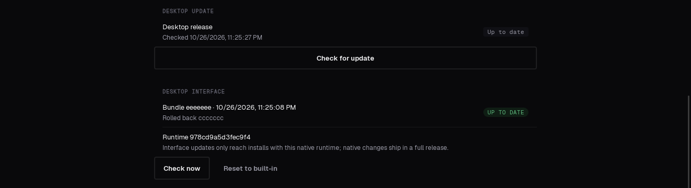

# Desktop over-the-air UI updates

The desktop app is a Tauri shell around the same react-native-web export the phone apps run. Phones
already take UI changes over the air (EAS Update, `.github/workflows/eas-update.yml`); desktop now
does too. A merge to `main` that changes the UI reaches installed desktop apps within about half an
hour, with no release and no reinstall. Anything that changes the **native** side still needs a
full release.

## What ships over the air

Only the web export (`mobile/dist`, the same files `tauri build` embeds as `frontendDist`). The
Rust shell, its plugins, its capabilities and its `tauri.conf.json` are never replaced.

## Runtime version: the compatibility gate

A bundle is only applied to a binary whose **runtime version** equals the one the bundle was
published for. The runtime version is a 16-hex-digit hash of everything native the UI depends on
(`mobile/src-tauri/runtime_version.rs`):

| Included | Why |
| --- | --- |
| `src/**/*.rs`, `build.rs`, `runtime_version.rs` | the commands the UI can `invoke` and how they behave |
| `Cargo.toml`, `Cargo.lock` | plugin and dependency versions |
| `capabilities/*.json` | what the UI is allowed to call |
| `tauri.conf.json`: `identifier`, `productName`, `app`, `plugins` | CSP, windows, updater key |
| `Info.plist` | macOS entitlements the shell runs with |

Left out on purpose: `version`, `build` and `bundle` in `tauri.conf.json` (release CI stamps
`version`; none of them change what the UI can call), icons, and line endings (CRLF is normalised).

`build.rs` bakes the value into the binary (`FORGE_DESKTOP_RUNTIME_VERSION`). CI computes it with
`mobile/src-tauri/tools/runtime-version`, which compiles the very same `runtime_version.rs`, so the
two cannot disagree (a unit test also checks `build.rs` against the module). Print it for any
checkout:

```sh
cargo run --release --manifest-path mobile/src-tauri/tools/runtime-version/Cargo.toml -- mobile/src-tauri
```

The runtime version is conservative by design: any Rust edit changes it, including ones that do not
touch an interface. Those changes need a full release anyway, because an installed binary cannot
pick them up.

### Forcing a full release

A UI change that needs new native behaviour (a new Tauri command, a new plugin, a capability, a
CSP change) changes the runtime version by itself: bundles for the new runtime are published, but
installed apps have the old one and ignore them until the new release is installed. Nothing extra
is needed. To make sure no installed app takes a given UI change over the air (a UI change that is
unsafe on an old shell), change a native input in the same PR or set the repository variable
`DESKTOP_OTA_MIN_APP_VERSION` to the release that must be installed first.

The first release that contains this feature carries the runtime version in its binary, so bundles
start applying to it as soon as it is installed. Installs older than that have no OTA support and
update the usual way.

## Publishing (`.github/workflows/desktop-ota.yml`)

On every push to `main` that touches `mobile/**` (but not only `mobile/src-tauri/**`):

1. Compute the runtime version and run `node scripts/export-web-clean.mjs`, the export the desktop
   build uses, with the same public environment.
2. `scripts/ci/desktop_ota_pack.py` zips `mobile/dist` deterministically and writes
   `manifest-<runtime>.json`:
   `{runtime_version, bundle_id (git sha), created_at (commit time, unix seconds), sha256, size, min_app_version}`.
3. Both files are signed with the Tauri updater key (`TAURI_SIGNING_PRIVATE_KEY` and
   `TAURI_SIGNING_PRIVATE_KEY_PASSWORD`, the secrets `app-desktop.yml` uses), then verified with the
   app's own verification code against the public key in `tauri.conf.json` before anything is
   uploaded.
4. Upload to the rolling **prerelease** `desktop-ota`: `bundle-<runtime>-<sha>.zip` (+ `.sig`) first,
   `manifest-<runtime>.json` (+ `.sig`) last, so a manifest never names a bundle that is not there.
5. Prune to the newest 5 bundles per runtime version.
6. Assert that the repository's Latest release is still a full release.

`desktop-ota` is a prerelease and is published with `--latest=false`: the Tauri updater reads
`releases/latest/download/latest.json`, and nothing here may disturb that. The concurrency group does
not cancel in-progress runs, so a publish is never cut half way.

## In the app (`mobile/src-tauri/src/ota.rs`)

- **Check.** About 5 seconds after launch (never before first paint) and every 30 minutes, it
  fetches `manifest-<runtime>.json` and its signature for its own runtime version from
  `https://github.com/Adulari/forge/releases/download/desktop-ota/`.
- **Verify.** The manifest signature is checked against the updater public key in `tauri.conf.json`
  before the manifest is parsed. A bundle is only downloaded when the manifest is for this runtime
  version, `min_app_version` is not above the installed version, the bundle is not blacklisted, and
  `created_at` is strictly newer than the embedded UI, the active bundle and any pending one. After
  download the size, the SHA-256 and the bundle's own signature must match.
- **Unpack.** Into a temporary directory under `<app data>/ota/bundles/`, rejecting any entry that
  escapes it or is a symlink and capping sizes, then renamed to `<bundle_id>/` in one step. It
  needs an `index.html`. The bundle becomes *pending*; the running UI is untouched.
- **Apply.** On the next launch, or from the "Reload to update" banner (and Settings, Diagnostics &
  updates), the pending bundle becomes active. The UI is served by a Tauri `Assets` implementation,
  so the origin stays `tauri://localhost`: IPC and capabilities apply unchanged, and localStorage,
  IndexedDB and AsyncStorage data survive the switch.
- **Crash safety.** A launch that serves a downloaded bundle is *booting* until the UI calls
  `ota_mark_healthy` (after the app shell has rendered, `mobile/src/lib/desktopOta.ts`). A bundle that
  has never been healthy is abandoned after one launch that never reported; one that has run fine
  before is allowed one such launch, because quitting during startup looks the same as a crash.
  Abandoning blacklists the bundle id and restores the last healthy bundle, or the embedded UI. A
  30 second in-process watchdog does the same without waiting for a relaunch.

State is `<app data>/ota/state.json`; the app data directory is the platform's (for Linux,
`~/.local/share/dev.adulari.forge/ota/`).

## Security model

The signature is the only trust anchor and it is the updater key already shipped in every binary:
an attacker who controls the release, the network or the cache can withhold updates but cannot make
an app run a UI they did not sign. Signed manifests bind the runtime version, bundle id, hash and
size; bundles are also signed individually. Replaying an old signed bundle is stopped by the
monotonic `created_at` rule and the blacklist. File names built from manifest fields are restricted
to a plain alphabet even though the manifest is signed. The bundle runs with exactly the privileges
the embedded UI has, which is why the runtime version gate exists.

## Opt-out and settings

| Setting | Effect |
| --- | --- |
| `FORGE_DESKTOP_OTA=0` | no check, no download, embedded UI always |
| file `<app data>/ota/disabled` | the same, persistently |
| Settings, Diagnostics & updates, **Reset to built-in** | drops every downloaded bundle and reloads into the embedded UI; those bundles stay blacklisted |
| `FORGE_DESKTOP_OTA_URL` | base URL of the manifest and bundles (tests) |
| `FORGE_DESKTOP_OTA_DIR` | where bundles and state live (tests) |
| repository variable `DESKTOP_OTA_MIN_APP_VERSION` | bundles are ignored by apps older than this |

Debug builds never use OTA bundles.

## What it looks like

Captured in the off-screen test harness with a throwaway signing key. The test bundle changes the
empty-state sentence; browser storage written before the switch was still there after it.

| Built-in UI | Bundle downloaded | After relaunch |
| --- | --- | --- |
|  |  |  |

Settings, Diagnostics & updates:



## Testing

- `cargo test` in `mobile/src-tauri`: manifest parsing, signature verification against a throwaway
  key, monotonicity, runtime mismatch, the rollback state machine, atomic unpacking, asset serving.
- `python3 scripts/ci/test_desktop_ota_pack.py`: packing and pruning.
- `mobile/src/lib/desktopOta.test.ts`: the web client.
- End to end: build the app with a test updater key (`TAURI_CONFIG` overriding
  `plugins.updater.pubkey`), serve a signed manifest and bundle from a local HTTP server through
  `FORGE_DESKTOP_OTA_URL`, and drive it in the off-screen harness.
